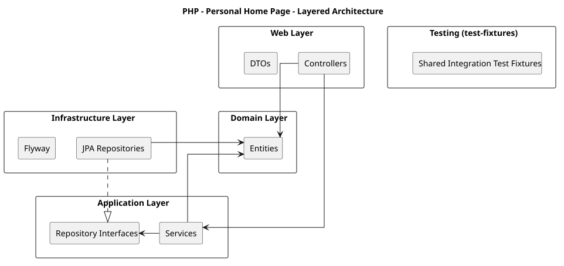

= PHP - Personal Home Page

image:https://github.com/Tais993/PHP/actions/workflows/gradle-build.yml/badge.svg?branch=develop[Build,link=https://github.com/Tais993/PHP/actions/workflows/gradle-build.yml]
image:https://sonarcloud.io/api/project_badges/measure?project=Tais993_PHP&metric=coverage[Coverage,link=https://sonarcloud.io/summary/new_code?id=Tais993_PHP]
image:https://sonarcloud.io/api/project_badges/measure?project=Tais993_PHP&metric=alert_status[Quality Gate,link=https://sonarcloud.io/summary/new_code?id=Tais993_PHP]
image:https://sonarcloud.io/api/project_badges/measure?project=Tais993_PHP&metric=sqale_rating[Maintainability Rating,link=https://sonarcloud.io/summary/new_code?id=Tais993_PHP]
image:https://sonarcloud.io/api/project_badges/measure?project=Tais993_PHP&metric=reliability_rating[Reliability Rating,link=https://sonarcloud.io/summary/new_code?id=Tais993_PHP]
image:https://sonarcloud.io/api/project_badges/measure?project=Tais993_PHP&metric=security_rating[Security Rating,link=https://sonarcloud.io/summary/new_code?id=Tais993_PHP]

PHP (Personal Home Page) is a self-hosted application for managing tasks, tracking deadlines, and organising work across multiple Kanban-style boards and sprint views.

The project started from a personal frustration with keeping track of TODOs, deadlines, and planned work. Its goal is to provide a unified browser homepage where daily tasks and long-term project work can be managed in one easily accessible place.

== Live Environments

[cols="1,2,2",options="header"]
|===
|Component |Platform |URL

|Frontend
|Cloudflare Workers
|https://php-frontend.tijs-ca5.workers.dev/boards/1[php-frontend.tijs-ca5.workers.dev^] (connected to Heroku backend)

|Backend (Dev)
|Azure Container Apps
|https://homepage-dev.calmrock-5a326db7.germanywestcentral.azurecontainerapps.io[homepage-dev on Azure^]

|Backend (Live)
|Heroku
|https://personal-home-page-30cd48c1ef7c.herokuapp.com/[personal-home-page on Heroku^]

|Documentation
|GitHub Pages
|https://tais993.github.io/PHP/[Documentation Site^]
|===

== Status & Features

=== Currently Implemented

* *Backend REST API*: Layered Clean Architecture for managing boards, tasks, statuses, and grouped board views.
* *Interactive Frontend*: React 19 + TypeScript + Vite SPA featuring Kanban boards with drag-and-drop task status transitions.
* *OpenAPI & Swagger UI*: Interactive API documentation and exploratory testing interface at `/api/swagger-ui/index.html`.
* *Continuous Delivery*: Automated CI/CD pipelines deploying backend containers to Azure Container Apps and frontend assets to Cloudflare Workers.
* *Containerisation*: Multi-stage Docker builds and Docker Compose support for local development and self-hosted environments.

=== Planned

* User accounts, authentication, and multi-user workflows
* Board customisation, tags, and deadline notifications
* Personal dashboard widgets and homepage integrations

== Project Structure

[source,text]
----
PHP/
    frontend/             React/Vite single-page application (deployed to Cloudflare Workers)
    backend/
        domain/           Core domain entities (Board, Task, BoardStatus, BoardView)
        application/      Services, use cases, and repository interfaces
        infrastructure/   JPA persistence, Flyway migrations, and domain mappers
        web/              Spring Boot entry point, REST controllers, DTOs, and OpenAPI config
        test-fixtures/    Shared test containers, base classes, and test fixtures
        buildSrc/         Gradle conventions for testing and coverage aggregation
    .github/workflows/    CI/CD, code quality analysis, Pages, and Docker publish workflows
    compose.dev.yaml      PostgreSQL container only (for local backend development)
    compose.yaml          Full stack compose: Spring Boot backend and PostgreSQL containers
    heroku.yml            Heroku Docker deployment manifest
----

The backend follows a layered architecture inspired by Clean Architecture:
* *Domain*: Core business models (`Task`, `Board`, `BoardStatus`, `BoardView`), independent of frameworks or databases.
* *Application*: Use cases, business logic, and repository contracts (`TaskService`, `BoardService`, `BoardViewService`).
* *Infrastructure*: Implements repository contracts with Spring Data JPA and PostgreSQL.
* *Web*: Handles HTTP requests, CORS, DTO transformations, validation, and Swagger documentation.

== Running the Project Locally

=== Prerequisites

* Java 27 JDK
* Node.js 24
* Docker Desktop or compatible Docker Engine

The repository includes a Gradle wrapper in `backend/`, so an external Gradle installation is not required.

=== Configuration Reference

==== Backend Environment Variables

Backend settings are configured in `backend/web/src/main/resources/application.properties` under the servlet context path `/api`.

[cols="1,2,1",options="header"]
|===
|Variable |Purpose |Default

|`PORT`
|HTTP server port (Heroku and Azure provide this automatically).
|`8080`

|`SPRING_DATASOURCE_URL`
|PostgreSQL JDBC connection string.
|`jdbc:postgresql://localhost:5434/homepage` (in compose)

|`SPRING_DATASOURCE_USERNAME`
|Database user.
|`homepage`

|`SPRING_DATASOURCE_PASSWORD`
|Database password.
|`homepage`

|`FRONTEND_ORIGINS`
|Comma-separated allowed CORS origins (scheme + host + port, no trailing slash).
|`http://localhost:5173,http://127.0.0.1:5173` (local profile)
|===

Example for a deployed environment:

[source,dotenv]
----
FRONTEND_ORIGINS=https://php-frontend.tijs-ca5.workers.dev
----

==== Frontend Environment Variables

Frontend configuration is centralised in `frontend/src/config.ts`. Copy `frontend/.env.example` to `frontend/.env.local` for local overrides:

[cols="1,2,1",options="header"]
|===
|Variable |Purpose |Default

|`VITE_API_BASE_URL`
|Public backend API base URL, including the `/api` prefix.
|`http://localhost:8080/api` (dev) / `/api` (prod)
|===

NOTE: `VITE_` variables are embedded into static assets during build time (`npm run build`). Changing the API URL for production requires rebuilding the frontend.

=== Local Development Steps

==== 1. Start the Backend

From the `backend/` directory:

[source,bash]
----
# Linux / macOS
./gradlew :web:bootRun

# Windows
gradlew.bat :web:bootRun
----

The `local` profile automatically starts PostgreSQL using `compose.dev.yaml` via Spring Boot Docker Compose integration. The backend listens at `http://localhost:8080/api`.

Alternatively, run the development database independently from the repository root:

[source,bash]
----
docker compose -f compose.dev.yaml up -d
----

==== 2. Start the Frontend

From the `frontend/` directory:

[source,bash]
----
npm ci
npm run dev
----

Open `http://localhost:5173` in your browser. The frontend connects to `http://localhost:8080/api` by default.

==== 3. Full Stack via Docker Compose

To launch the complete containerised stack (backend and PostgreSQL 17) locally:

[source,bash]
----
docker compose up -d --build
----

* API is accessible at `http://localhost:8080/api`
* PostgreSQL is exposed on port `5434`
* To stop the containers while preserving database volume: `docker compose down`

== REST API & OpenAPI Documentation

Interactive API documentation and schema exploration are provided by SpringDoc OpenAPI.

* *Swagger UI*: `http://localhost:8080/api/swagger-ui/index.html` (or `<backend-url>/api/swagger-ui/index.html`)
* *OpenAPI JSON*: `http://localhost:8080/api/v3/api-docs`

=== Core Endpoints Summary

All routes are served relative to the `/api` context path:

[cols="1,2,3",options="header"]
|===
|Method |Endpoint |Description

3+|*Boards*
|`POST` |`/api/boards` |Create a new board (`201 Created`)
|`GET` |`/api/boards` |List all boards (`200 OK`)
|`GET` |`/api/boards/+{id}+` |Get board details by ID (`200 OK` or `404 Not Found`)
|`GET` |`/api/boards/+{boardId}+/tasks` |Get all tasks belonging to a board (`200 OK`)
|`GET` |`/api/boards/+{boardId}+/views` |Get all views configured for a board (`200 OK`)
|`DELETE` |`/api/boards/+{id}+` |Delete a board by ID (`204 No Content`)

3+|*Tasks*
|`POST` |`/api/tasks` |Create a new task (`201 Created`)
|`GET` |`/api/tasks` |List all tasks across boards (`200 OK`)
|`GET` |`/api/tasks/+{id}+` |Get task details by ID (`200 OK` or `404 Not Found`)
|`POST` |`/api/tasks/+{id}+/status` |Update task status / column (`200 OK`)
|`DELETE` |`/api/tasks/+{id}+` |Delete a task by ID (`204 No Content`)

3+|*Views*
|`GET` |`/api/views/+{viewId}+` |Get a specific board view configuration (`200 OK`)
|`GET` |`/api/views/+{viewId}+/tasks` |Get board tasks grouped by status for Kanban rendering (`200 OK`)
|===

== Deployment

=== 1. Azure Container Apps (Backend)

The repository includes continuous deployment for the backend on pushes to the `develop` branch via `.github/workflows/docker-publish.yml`.

1. *Image Publishing*: GitHub Actions builds the multi-stage Docker image and publishes it to GitHub Container Registry (`ghcr.io/tais993/php:develop-<sha>`).
2. *Azure Deployment*: The `deploy-azure` job logs into Azure using OpenID Connect (OIDC) and updates the Container App `homepage-dev` in resource group `rg-homepage-dev`.
3. *Required GitHub Secrets*:
   * `AZURE_CLIENT_ID`
   * `AZURE_TENANT_ID`
   * `AZURE_SUBSCRIPTION_ID`
4. *Container App Environment Variables*:
   * `PORT`: Set or handled by Azure Container Apps ingress.
   * `SPRING_DATASOURCE_URL`: PostgreSQL connection URL (e.g., Azure Database for PostgreSQL).
   * `SPRING_DATASOURCE_USERNAME` / `SPRING_DATASOURCE_PASSWORD`: Database credentials.
   * `FRONTEND_ORIGINS`: Origin of the deployed frontend (e.g., `https://php-frontend.tijs-ca5.workers.dev`).

=== 2. Heroku (Backend)

Heroku deployment is configured via `heroku.yml` using container builds.

1. *Configuration*: `heroku.yml` specifies building the `Dockerfile` for the `web` process.
2. *Setup*:
+
[source,bash]
----
heroku create <app-name>
heroku stack:set container
heroku addons:create heroku-postgresql:essential-0
----
3. *Config Vars*:
   * `SPRING_DATASOURCE_URL`: PostgreSQL JDBC URL.
   * `SPRING_DATASOURCE_USERNAME` / `SPRING_DATASOURCE_PASSWORD`: Postgres credentials.
   * `FRONTEND_ORIGINS`: Allowed frontend origin URL(s).
   * `PORT`: Injected automatically by Heroku.
4. *Deploy*: Push changes to Heroku Git:
+
[source,bash]
----
git push heroku main
----

=== 3. Cloudflare Workers (Frontend)

The frontend is served as static assets through Cloudflare Workers as configured in `frontend/wrangler.jsonc`.

1. *Cloudflare Project Settings*:
   * *Root directory*: `frontend`
   * *Build command*: `npm run build`
   * *Deploy command*: `npx wrangler deploy`
2. *Build Environment Variables*:
   * `NODE_VERSION`: `24`
   * `VITE_API_BASE_URL`: Public HTTPS backend URL including `/api` (e.g., `https://personal-home-page-30cd48c1ef7c.herokuapp.com/api` or `https://homepage-dev.calmrock-5a326db7.germanywestcentral.azurecontainerapps.io/api`).
3. *Routing*: `wrangler.jsonc` specifies `"not_found_handling": "single-page-application"`, ensuring direct navigation and page reloads (e.g. `/boards/1`) route correctly to `index.html`.
4. *CORS*: After obtaining the Cloudflare URL, add it to `FRONTEND_ORIGINS` in your backend deployment.

=== 4. Self-Hosted (Docker Compose)

For production hosting on your own server or VPS:

1. Clone repository and configure environment variables in `.env`:
+
[source,dotenv]
----
FRONTEND_ORIGINS=https://your-frontend.example.com
----
2. Run `docker compose up -d` to launch the backend and PostgreSQL containers.

== Testing & Verification

Commands are executed from the `backend/` directory:

=== Unit Tests

[source,bash]
----
./gradlew test
----

=== Integration Tests

Integration tests use Testcontainers to spin up isolated PostgreSQL instances:

[source,bash]
----
./gradlew integrationTest
----

NOTE: Docker must be running for integration tests.

=== Verification & Build

Run all checks, linters, and verification tasks:

[source,bash]
----
./gradlew check
./gradlew build
----

=== Code Coverage

JaCoCo generates aggregated unit and integration coverage reports:

[source,bash]
----
./gradlew testAllWithAggregateCoverage
----

Reports are generated in:
* `backend/build/reports/jacoco/unit/html/`
* `backend/build/reports/jacoco/integration/html/`

== Continuous Integration & Workflows

GitHub Actions workflows in `.github/workflows/` manage CI/CD:

* *Gradle Build*: Validates backend builds.
* *Unit & Integration Tests*: Executes test suites and uploads coverage to SonarCloud & Codecov.
* *SonarQube*: Analyses maintainability, security, and test coverage.
* *Docker & Docker Publish*: Validates container builds and publishes images to GitHub Packages (`ghcr.io`).
* *Deploy to Azure*: Deploys `develop` container releases to Azure Container Apps.
* *Documentation Pages*: Renders PlantUML diagrams and builds the Antora AsciiDoc site to GitHub Pages.

== Documentation Site

The project documentation is built with Antora and AsciiDoc, hosted at https://tais993.github.io/PHP/[GitHub Pages^].

To build the documentation site locally (requires Node.js 24 and JDK 25+):

[source,bash]
----
./backend/gradlew -p .docs renderDiagrams
npm --prefix .docs ci
npm --prefix .docs run build
----

Open `.docs/build/site/index.html` in your browser.

== Technologies

* *Backend*: Java 27, Spring Boot 3 (Web MVC, Data JPA), Hibernate, Flyway, SpringDoc OpenAPI (Swagger UI)
* *Frontend*: React 19, TypeScript, Vite, Tailwind CSS, Lucide Icons
* *Database*: PostgreSQL 17
* *Testing*: JUnit 5, Mockito, Testcontainers, JaCoCo, SonarCloud, Codecov
* *Hosting & DevOps*: Docker, Docker Compose, Azure Container Apps, Heroku, Cloudflare Workers, GitHub Actions, GitHub Pages
