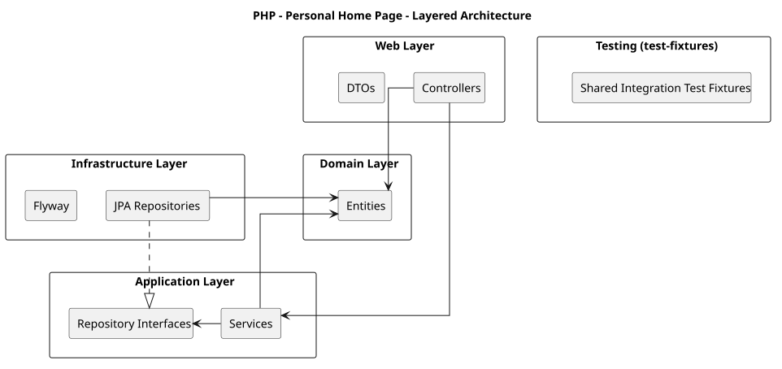

= PHP - Personal Home Page

image:https://github.com/Tais993/PHP/actions/workflows/gradle-build.yml/badge.svg?branch=develop[Build,link=https://github.com/Tais993/PHP/actions/workflows/gradle-build.yml]
image:https://sonarcloud.io/api/project_badges/measure?project=Tais993_PHP&metric=coverage[Coverage,link=https://sonarcloud.io/summary/new_code?id=Tais993_PHP]
image:https://sonarcloud.io/api/project_badges/measure?project=Tais993_PHP&metric=alert_status[Quality Gate,link=https://sonarcloud.io/summary/new_code?id=Tais993_PHP]
image:https://sonarcloud.io/api/project_badges/measure?project=Tais993_PHP&metric=sqale_rating[Maintainability Rating,link=https://sonarcloud.io/summary/new_code?id=Tais993_PHP]
image:https://sonarcloud.io/api/project_badges/measure?project=Tais993_PHP&metric=reliability_rating[Reliability Rating,link=https://sonarcloud.io/summary/new_code?id=Tais993_PHP]
image:https://sonarcloud.io/api/project_badges/measure?project=Tais993_PHP&metric=security_rating[Security Rating,link=https://sonarcloud.io/summary/new_code?id=Tais993_PHP]

PHP (Personal Home Page) is a self-hosted application for managing tasks and eventually, organising work across multiple boards and sprints.

The project started from my personal frustration with keeping tracks of TODOs, deadlines and work planned. Its goal is to provide a personal browser homepage where daily tasks and long-term work can be managed in one easily accessible place.

== Status
This project is under active development.

The current version is merely for testing, but the next version will focus on the following:

* Maintaining and creating TODOs
* Creating and organising boards

Some planned features, such as user account creation, are still in development.

== Features

=== Currently implemented

* REST endpoints for creating, retrieving and deleting tasks

=== Planned

* Browser-based task management interface
* Multiple boards with Kanban style
* Task editing and status management through the website
* User accounts and multi-user workflows

== Project Structure

[source,text]
----
PHP/
    backend/
        domain/           Core domain entities
        application/      Services, use cases and repository contracts
        infrastructure/   JPA persistence, mapping and database migrations
        web/              Spring Boot entry point, REST controllers and DTOs
        test-fixtures/    Shared test containers, annotations and fixtures
        buildSrc/         Gradle conventions for testing and coverage
    .github/workflows/    CI, quality analysis and Docker workflows
    compose.dev.yaml      PostgreSQL only, for local development
    compose.yaml          Application and PostgreSQL containers
----

The backend follows a layered architecture inspired by Clean Architecture. The domain contains the core models. The application layer defines business logic and repository contracts they need. The infrastructure implements those contracts using JPA and PostgreSQL. And last but not least, the web layer handles HTTP request.

Dependencies are organised so that the core business behaviour does not need to know about database implementations. JPA entities and mapping code are kept in infrastructure rather than in the domain model.

== Running the project

=== Prerequisites

* Java 27 JDK
* Docker Desktop or another Docker Engine

The repository includes a Gradle wrapper, so a Gradle installation is not required.

=== Configuration

All backend Gradle commands are executed from the `backend` directory.

[source,bash]
----
cd backend
----

The Spring Boot configuration files are in `backend/web/src/main/resources/`:

* `application.properties` contains shared application settings.
* `application-local.properties` selects the development Compose configuration.

The `:web:bootRun` task activates the `local` Spring profile automatically.

The default Docker Compose figuration uses the database `homepage`, username and password are both `homepage`, with PostgreSQL exposed on port `5434`. Replace the credentials before deploying to a live environment.

== Local development

Start the Spring Boot backend:

[source,bash]
----
cd backend
./gradlew :web:bootRun
----

On Windows, use `gradlew.bat` instead of `./gradlew`.

In the local profile, Spring Boot is configured to use `compose.dev.yaml`. This profile only runs PostgreSQL. This allows the backend to be ran locally for development and debugging.

The backend usually listens to `http://localhost:8080`. At present, this exposes REST endpoints.

If you rather run the development database manually, run the following command from the repository root:

[source,bash]
----
docker compose -f compose.dev.yaml up -d
----

Avoid running the full application container and `bootRun` simultaneously on port `8080`.

=== Docker

To run both the application and its PostgreSQL database in container, run this from the repository root.

[source,bash]
----
docker compose up -d --build
----

The full `compose.yaml` defines the application's container and a PostgreSQL 17 container with a persistent PostgreSQL volume. The app is exposed on `http://localhost:8080`.

To stop the containers:

[source,bash]
----
docker compose down
----

This keeps the database volume. Do not add `-v` unless you intentionally want to remove the Compose-managed volume and its stored data.

=== REST API

The current controller exposes these routes:
[cols="1,2,3",options="header"]
|===
|Method |Endpoint |Description
|`POST` |`/task` |Create a task from a JSON request; returns `201 Created`
|`GET` |`/task?id=1` |Retrieve a task by ID; returns `404 Not Found` if it does not exist
|`DELETE` |`/task?id=1` |Delete a task by ID; returns `204 No Content` on success
|===

Any more on this will be discussed later, Swagger UI will be added.

== Testing

Tests are split up into unit and integration tests. Integration tests are marked with a JUnit tag named `integration`. They are run separately.

Integration tests use Testcontainers to run against PostgreSQL rather to rely on the developer's local database.

Run commands from the `backend` directory.

=== Unit tests

[source,bash]
----
./gradlew test
----

=== Integration tests

[source,bash]
----
./gradlew integrationTest
----

Docker must be available for integration tests that start PostgreSQL through Testcontainers.

=== Run all tests

[source,bash]
----
./gradlew check
----

The project's testing conventions configure `check` to depend on integration tests. For a complete build including verification, use:

[source,bash]
----
./gradlew build
----

=== Code coverage

JaCoCo generates separate unit and integration coverage reports. To run both tests and produce aggregated reports:\

[source,bash]
----
./gradlew testAllWithAggregateCoverage
----

The aggregated HTML reports are generated in:

[source,text]
----
backend/build/reports/jacoco/unit/html/
backend/build/reports/jacoco/integration/html/
----

The matching XML are used by CI and Sonarcloud. The `test-fixtures` module is excluded from coverage.

=== Continuous integration

GitHub Actions workflows automate building, testing, code analysis and container publishing:

* *Gradle Build* assembles the Java backend.
* *Unit Tests* executes the unit test suite and publishes coverage.
* *Integration Tests* executes the integration suite and publishes coverage.
* *SonarQube* analyses the code and uses the generated JaCoCo reports.
* *Docker* checks the container build.
* *Docker Publish* publishes a container image to GitHub Container Registry following the configured successful workflow on `main`.
* *Dependency Graph* supports repository dependency reporting.

Coverage is also uploaded to Codecov. The workflows are defined in `.github/workflows/`.

== Documentation

Further project documentation is maintained in the project portfolio:

* Project plan
* Analysis document
* Architecture / design document
* Management document

== Technologies

* Java 27
* Gradle
* Docker and Docker Compose
* PostgreSQL 17

* Flyway
* JaCoCo
* SonarQube and CodeCov

=== Spring Boot
* Web MVC
* Data JPA/Hibernate